# Nexus — artifact management for Buy-02

Sonatype Nexus Repository (Community Edition) stores the backend JARs and Docker images built by CI,
and proxies Maven Central so every Maven build gets its dependencies through Nexus.
Decisions and reasons: [ADR 001](adr/001-nexus.md). Screenshots: [`images/`](images/).

| | Server | Local |
| --- | --- | --- |
| UI + Maven | `https://nexus.ayoubnachti.dev` | `http://localhost:8090` |
| Docker registry | `registry.ayoubnachti.dev` | `localhost:8082` |
| Jenkins job | `https://jenkins.ayoubnachti.dev/job/Nexus/` | — |

No password appears in this file, in the repo or in any screenshot.

## 1. Setup

### Start Nexus

```bash
# local
docker compose -f nexus/compose.yml up -d
# server (no published ports, served by Caddy over HTTPS)
docker compose -f nexus/compose.yml -f nexus/compose.server.yml up -d

docker compose -f nexus/compose.yml ps     # wait for "(healthy)", 1-3 min
```

[`nexus/compose.yml`](../nexus/compose.yml): official image `sonatype/nexus3:3.98.1` (pinned), data in the
`nexus_data` volume, memory capped at 4 GB, ports bound to `127.0.0.1` only.

### Not root

```bash
docker exec nexus id      # uid=200(nexus) gid=200(nexus)
```

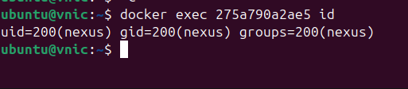

### First login

```bash
docker exec nexus cat /nexus-data/admin.password   # Git Bash: export MSYS_NO_PATHCONV=1 first
```

Log in as `admin`, set a new password, **disable anonymous access**. Check without logging in:

```bash
curl -s -o /dev/null -w '%{http_code}\n' https://nexus.ayoubnachti.dev/service/rest/v1/status/check   # 401
```

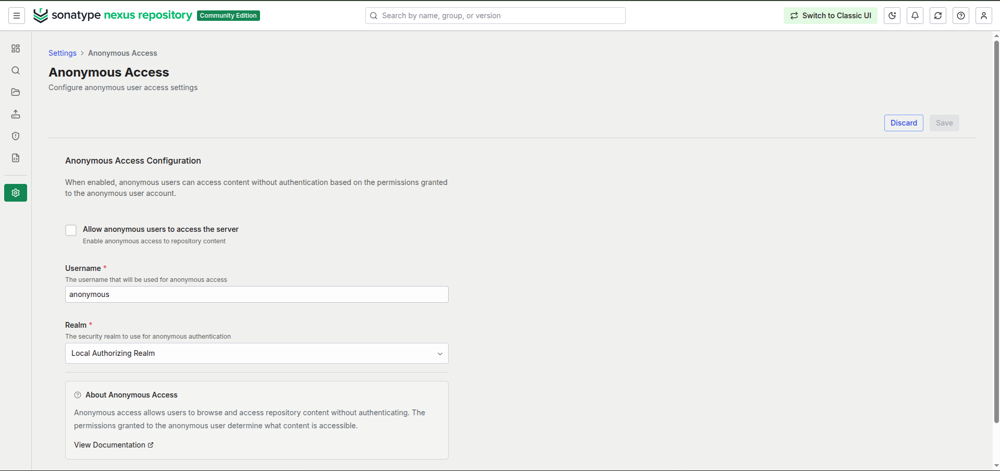

### Repositories

| Name | Type | Settings |
| --- | --- | --- |
| `maven-releases` | Maven hosted | Release, **Disable redeploy** (a version is never overwritten) |
| `maven-snapshots` | Maven hosted | Snapshot, Allow redeploy |
| `maven-central` | Maven proxy | `https://repo1.maven.org/maven2/` |
| `maven-public` | Maven group | releases + snapshots + central: the only URL builds use |
| `docker-hosted` | Docker hosted | HTTP connector 8082 (Caddy does HTTPS), Force Basic Auth, Disable redeploy |

*Settings → Security → Realms*: **Docker Bearer Token Realm** active (needed for `docker login`).

The services are Spring Boot apps packaged as **JARs**; `maven-releases` accepts any Maven packaging (JAR or WAR).

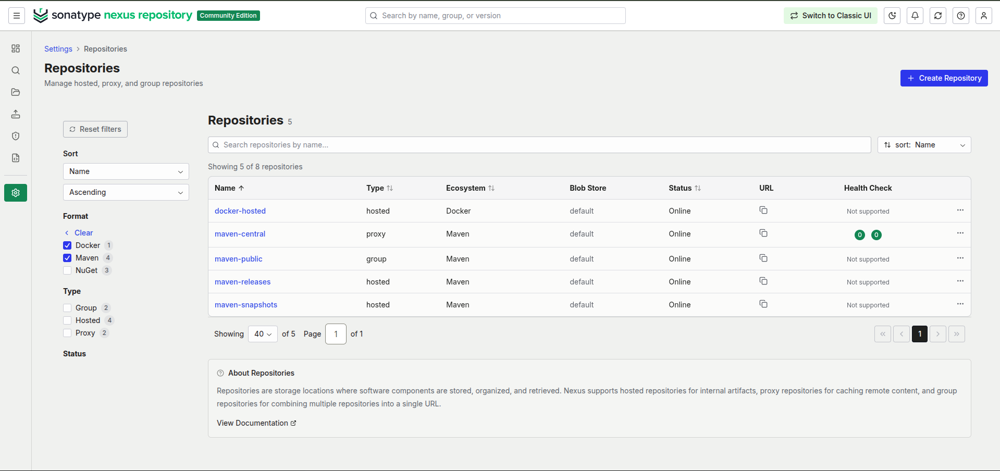

## 2. Maven

### `settings.xml` (repo root)

- `<mirror>` `nexus-public`, `mirrorOf *` → every download goes to `maven-public`.
- `<server>` entries `nexus-public`, `nexus-releases`, `nexus-snapshots` with `${env.NEXUS_USER}` /
  `${env.NEXUS_PASSWORD}`: credentials come from the environment, never from the file.

```bash
export NEXUS_URL=https://nexus.ayoubnachti.dev   # no trailing slash
export NEXUS_USER=<your user>
read -rs NEXUS_PASSWORD && export NEXUS_PASSWORD  # not stored on disk or in history
```

### Resolution through the proxy

With an empty local cache, every dependency comes from Nexus:

```bash
cd backend/cart-service
./mvnw -s ../../settings.xml -B package -DskipTests -Dmaven.repo.local=/tmp/empty-m2
# Downloading from nexus-public: https://nexus.ayoubnachti.dev/repository/maven-public/...
```

Nexus keeps a copy of each one in `maven-central`.

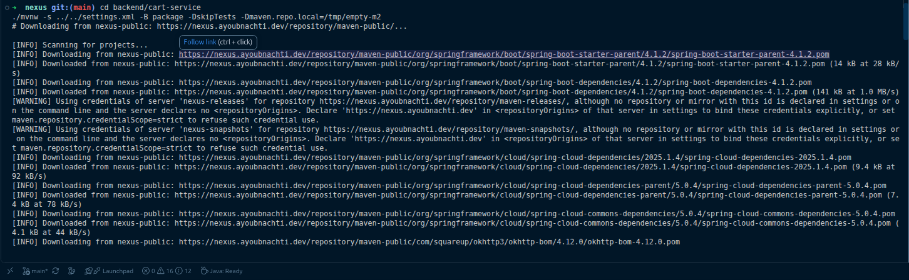
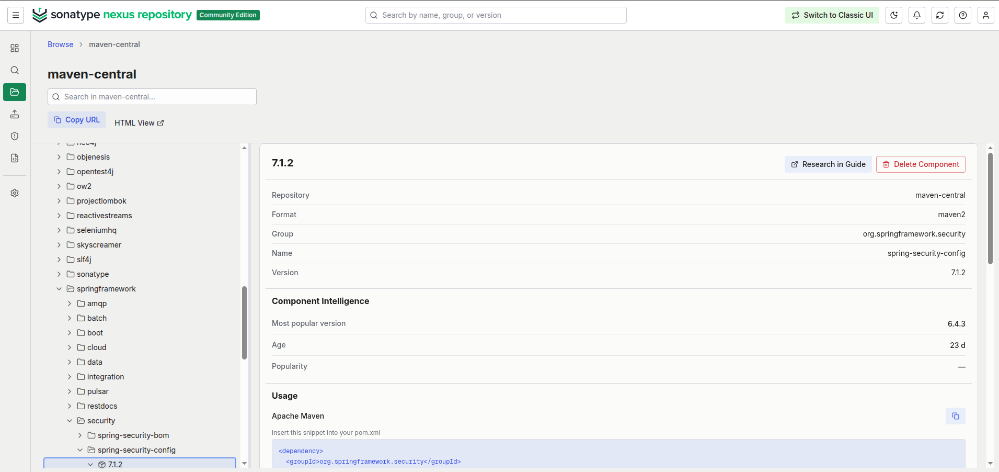

### Publishing

Each service's pom has `<version>${revision}</version>` (default `0.0.0-SNAPSHOT`), the flatten plugin
(the published pom carries the real version) and `distributionManagement` → `nexus-releases` / `nexus-snapshots`.

```bash
./mvnw -s ../../settings.xml -B deploy -DskipTests          # a developer: snapshot → maven-snapshots
```

Releases (`1.0.N`) are published only by CI (section 4).


## 3. Docker

```bash
docker login registry.ayoubnachti.dev -u <your user>
docker tag ecommerce/cart-service:dev registry.ayoubnachti.dev/ecommerce/cart-service:<version>   # push: CI user only
docker push registry.ayoubnachti.dev/ecommerce/cart-service:<version>
docker pull registry.ayoubnachti.dev/ecommerce/cart-service:1.0.10
docker logout registry.ayoubnachti.dev
```

Images are built on the ARM64 server, so they are **`linux/arm64`**. On an x86 machine, pull with
`docker pull --platform linux/arm64 …` (Podman: `podman pull --arch arm64 …`); running them there needs emulation.


## 4. CI (Jenkins)

A push or PR on GitHub triggers the `Nexus` multibranch job (webhook). All Maven commands use
`-s settings.xml` as user `ci-deployer` (Jenkins credential `nexus-ci`).

| Build | Tests + analysis | Build images | Deploy + E2E | Publish |
| --- | --- | --- | --- | --- |
| Pull request | ✅ | — | — | — |
| `main` (push/merge) | ✅ | ✅ | ✅ | ✅ |
| `main` nightly | ✅ | — | — | — |

- **Build images** packages the 7 JARs through Nexus as `1.0.<build#>`; the Dockerfiles only copy `target/*.jar`.
- **Publish** (after E2E passed) uploads those exact JARs to `maven-releases` and pushes the 8 images to
  `registry.ayoubnachti.dev/ecommerce/<svc>:1.0.<build#>`. If it fails, the deploy rolls back to `last-good`.

So every `1.0.N` in Nexus is a reviewed, tested, deployed `main` build N.


## 5. Versioning and rollback

`1.0.N` = Jenkins build N of `main` = one commit (shown on the build page). Releases are immutable.

### Versions in Nexus

```bash
curl -s -u "$NEXUS_USER:$NEXUS_PASSWORD" \
  "$NEXUS_URL/service/rest/v1/search?repository=maven-releases&name=cart-service" | grep '"version"'
# "version" : "1.0.10"
# "version" : "1.0.11"
```


### Download a given version

```bash
./mvnw -s settings.xml dependency:get -Dartifact=com.ecommerce:cart-service:1.0.10
curl -fu "$NEXUS_USER:$NEXUS_PASSWORD" -O \
  "$NEXUS_URL/repository/maven-releases/com/ecommerce/cart-service/1.0.10/cart-service-1.0.10.jar"
```

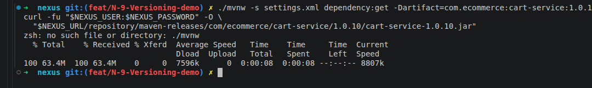

### From version to build and commit

Version `1.0.10` was published by build #10 of `main`; its page shows the commit and the merged PR.

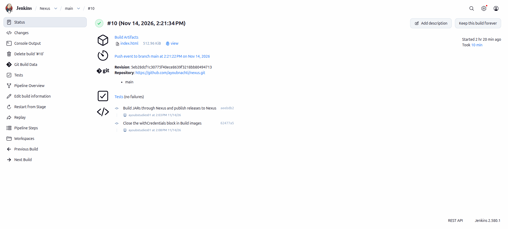

### Pull an older image

```bash
docker login registry.ayoubnachti.dev -u <your user>
docker pull --platform linux/arm64 registry.ayoubnachti.dev/ecommerce/cart-service:1.0.10
```

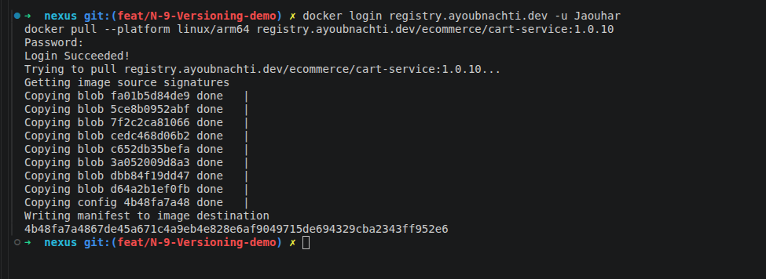

### Rollback (on the server, where the arm64 images run)

Which version is live (local tags are the build number: `ecommerce/<svc>:11` = release `1.0.11`):

```bash
docker ps --format '{{.Names}}\t{{.Image}}' | grep ecommerce
```


Roll back to `1.0.10`, pulled from Nexus (the registry requires a login, even to pull):

```bash
V=1.0.10
read -rs P && echo "$P" | docker login registry.ayoubnachti.dev -u <your user> --password-stdin && unset P
for s in discovery-server api-gateway user-service product-service media-service order-service cart-service frontend; do
  docker pull registry.ayoubnachti.dev/ecommerce/$s:$V
  docker tag  registry.ayoubnachti.dev/ecommerce/$s:$V ecommerce/$s:$V
done
docker logout registry.ayoubnachti.dev

# app settings and compose file, temporarily (they contain secrets)
cd ~/mr-jenk
grep '^APP_ENV_B64=' jenkins/.env | cut -d= -f2- | base64 -d > /tmp/app.env
git show origin/main:compose.yml > /tmp/compose.yml

# --no-build --pull never: use only the images pulled above, never build or pull on its own
TAG=$V docker compose -p ecommerce -f /tmp/compose.yml --env-file /tmp/app.env up -d --wait --no-build --pull never
docker ps --format '{{.Names}}\t{{.Image}}' | grep ecommerce     # now ecommerce/<svc>:1.0.10
```

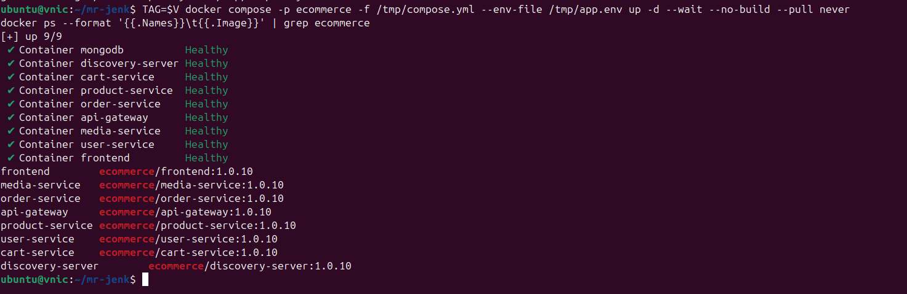

Back to the latest release (its images are still local, tagged with the build number), then clean up:

```bash
TAG=11 docker compose -p ecommerce -f /tmp/compose.yml --env-file /tmp/app.env up -d --wait --no-build --pull never
rm -f /tmp/app.env /tmp/compose.yml
```

## 6. Security (bonus)

Anonymous access is off. Two custom roles, built only from repository-level privileges
(`nx-repository-view-<format>-<repo>-<action>`); no role has `delete` or admin rights.

| Role | `maven-releases` | `maven-snapshots` | `maven-public` | `docker-hosted` |
| --- | --- | --- | --- | --- |
| `ci-deployer-role` | write + read | write + read | read | write + read |
| `developer-role` | read | write + read | read | read |

| User | Role |
| --- | --- |
| `ci-deployer` | `ci-deployer-role` (Jenkins only) |
| `youssef`, `Ayoub` | `developer-role` |
| `admin` | administration only, never CI |

So only CI can publish a release or push an image. A developer trying it is refused:

```bash
# publish a release by hand → 403
curl -s -o /dev/null -w '%{http_code}\n' -u <developer> -T x.jar \
  "$NEXUS_URL/repository/maven-releases/com/ecommerce/x/1.0.0/x-1.0.0.jar"
# push an image → denied
docker login registry.ayoubnachti.dev -u <developer>
docker tag ecommerce/cart-service:dev registry.ayoubnachti.dev/ecommerce/test:denied
docker push registry.ayoubnachti.dev/ecommerce/test:denied
```

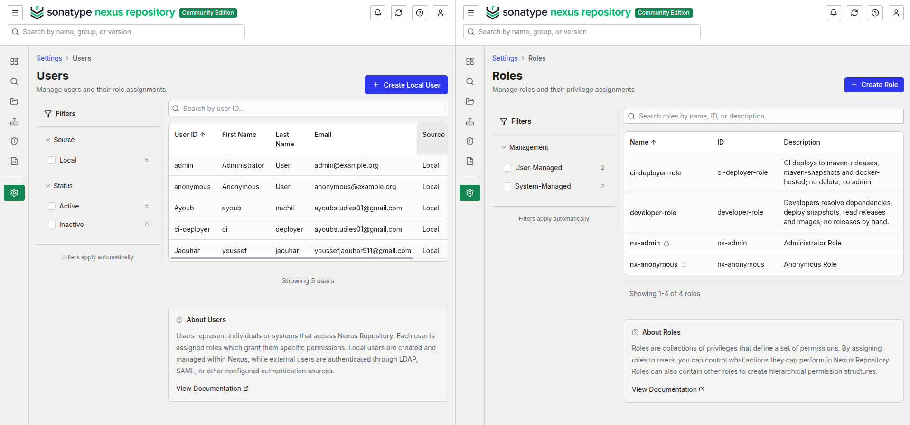
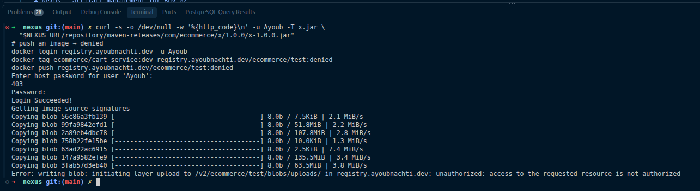

## 7. Audit checklist

| Audit question | Where |
| --- | --- |
| Nexus installed on a local or remote server | [§1 Start Nexus](#start-nexus) |
| Not running as root | [§1 Not root](#not-root) |
| Repositories for JARs, WARs, Docker images | [§1 Repositories](#repositories) |
| Spring Boot web application | `backend/` (7 services), live at `https://shop.ayoubnachti.dev` |
| Proper Maven structure | Standard layout per service; 7 independent projects, so no parent pom |
| Maven publishes artifacts to Nexus | [§2 Publishing](#publishing), [§4](#4-ci-jenkins) |
| Nexus as a proxy for dependencies | [§2 Resolution](#resolution-through-the-proxy) |
| Dependencies resolved from Nexus | [§2 Resolution](#resolution-through-the-proxy) |
| Versioning implemented | [§4](#4-ci-jenkins), [§5](#5-versioning-and-rollback) |
| Versions retrieved and managed | [§5](#5-versioning-and-rollback) |
| Docker repository, image published | [§3](#3-docker), [§4](#4-ci-jenkins) |
| Pipeline builds, tests, publishes on changes | [§4](#4-ci-jenkins) |
| Documentation with screenshots and examples | This file |
| Bonus: authentication, RBAC, repository permissions, restricted access | [§6](#6-security-bonus) |

**Notes:**
- **Maven only:** the frontend's npm packages come from npmjs (out of scope, see ADR).
- **Maven wrapper:** `./mvnw` downloads Maven itself once, from `repo.maven.apache.org`; all project dependencies go through Nexus.
- **Running locally:** `./scripts/build-jars.sh` (builds the JARs through Nexus), then `docker compose up --build`.
  With Podman, use `podman compose`; if short image names don't resolve, add
  `unqualified-search-registries = ["docker.io"]` to `~/.config/containers/registries.conf`.