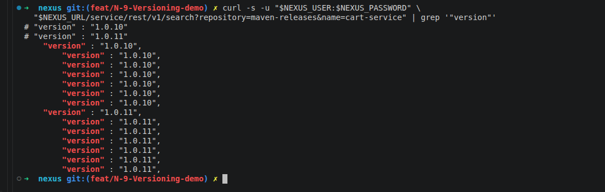
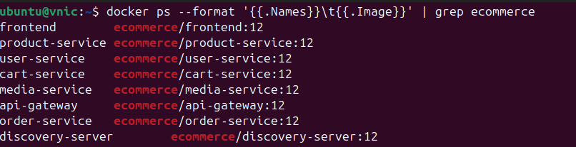

## 5. Versioning and rollback

`1.0.N` = Jenkins build N of `main` = one commit (shown on the build page). Releases are immutable.

### Versions in Nexus

```bash
curl -s -u "$NEXUS_USER:$NEXUS_PASSWORD" \
  "$NEXUS_URL/service/rest/v1/search?repository=maven-releases&name=cart-service" | grep '"version"'
# "version" : "1.0.10"
# "version" : "1.0.11"
```



### Download a given version

```bash
./mvnw -s settings.xml dependency:get -Dartifact=com.ecommerce:cart-service:1.0.10
curl -fu "$NEXUS_USER:$NEXUS_PASSWORD" -O \
  "$NEXUS_URL/repository/maven-releases/com/ecommerce/cart-service/1.0.10/cart-service-1.0.10.jar"
```


### From version to build and commit

Version `1.0.10` was published by build #10 of `main`; its page shows the commit and the merged PR.


### Pull an older image

```bash
docker login registry.ayoubnachti.dev -u <your user>
docker pull --platform linux/arm64 registry.ayoubnachti.dev/ecommerce/cart-service:1.0.10
```


### Rollback (on the server, where the arm64 images run)

Which version is live (local tags are the build number: `ecommerce/<svc>:11` = release `1.0.11`):

```bash
docker ps --format '{{.Names}}\t{{.Image}}' | grep ecommerce
```



Roll back to `1.0.10`, pulled from Nexus:

```bash
V=1.0.10
for s in discovery-server api-gateway user-service product-service media-service order-service cart-service frontend; do
  docker pull registry.ayoubnachti.dev/ecommerce/$s:$V
  docker tag  registry.ayoubnachti.dev/ecommerce/$s:$V ecommerce/$s:$V
done
# app settings and compose file, temporarily (they contain secrets)
cd ~/mr-jenk
grep '^APP_ENV_B64=' jenkins/.env | cut -d= -f2- | base64 -d > /tmp/app.env
git show origin/main:compose.yml > /tmp/compose.yml
TAG=$V docker compose -p ecommerce -f /tmp/compose.yml --env-file /tmp/app.env up -d --wait
docker ps --format '{{.Names}}\t{{.Image}}' | grep ecommerce     # now ecommerce/<svc>:1.0.10
```


Back to the latest release, then clean up:

```bash
TAG=11 docker compose -p ecommerce -f /tmp/compose.yml --env-file /tmp/app.env up -d --wait
rm -f /tmp/app.env /tmp/compose.yml
```